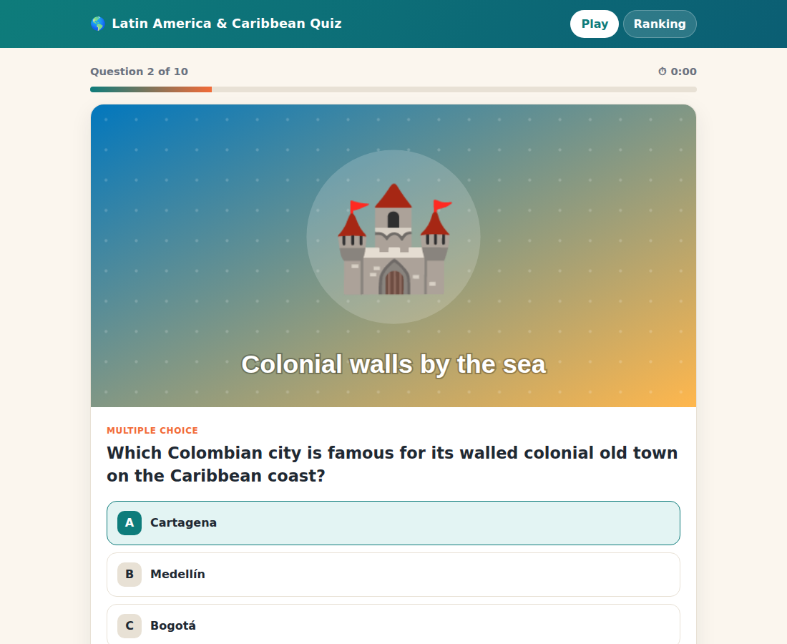

# QuizCulture — Latin America & Caribbean Quiz



Same stack as WC2026 / GSYFIFA2026: **Flask + vanilla JS + JSON files**, behind nginx and a Cloudflare Tunnel, managed by systemd. Everything (backend, player page, admin page, the 20 seed questions and their images) lives in **one file: `app.py`**.

| | |
|---|---|
| Port | `5052` (127.0.0.1 only, gunicorn 1 worker / 8 threads) |
| App | `/opt/quiz2026/app.py` |
| Data | `/opt/quiz2026/data/` → `questions.json`, `players.json`, `settings.json`, `images/` |
| Config | `/etc/quiz2026.env` → `QUIZ_ADMIN_PIN`, `QUIZ_DATA_DIR` |
| Service | `quiz2026.service` |

## How it plays

1. Player enters **Name + Email** → gets **10 random questions** from the bank (20 seeded; A/B/C/D answers shuffled per player).
2. One question per page: image, question, A/B/C/D or True/False, **← Back / Next →**, and **Finish ✓** on the last page. Next is enabled once the question is answered.
3. Result page: score, time, rank. One attempt per email (refresh or re-entering the same email resumes an unfinished attempt with the same clock).
4. **Ranking**: score ↓, then fastest time ↑ (server clock, start → finish). Emails are masked (`an•••@domain.com`).

## Admin — `/admin`

- **Questions**: add / edit / delete, A/B/C/D or True/False, mark correct answer, **upload image** (png/jpg/webp/gif/svg, max 5 MB), active/inactive, optional explanation.
- **Players**: status, score, time, delete one player (lets them replay), **Reset all**, **Export CSV**.
- **Settings**: title/subtitle, questions per quiz, open/close quiz, public ranking on/off, reveal correct answers on result page, shuffle options.

## Deploy via GitHub

**1. From the laptop (once):**

```bat
cd %USERPROFILE%\Dev\QuizCulture
git init -b main
git add .
git commit -m "Quiz 2026 - initial version"
git remote add origin https://github.com/alcosta35/QuizCulture.git
git push -u origin main
```

**2. On serverlab (first install):**

```bash
cd ~ && git clone https://github.com/alcosta35/QuizCulture.git
cd QuizCulture && sudo bash install.sh
# optional: QUIZ_HOST=quiz.alcosta-cse.net QUIZ_PORT=5052 sudo -E bash install.sh
```

If the repo is private, use a GitHub Personal Access Token as the password when cloning.

**3. Updates:** commit + push from the laptop, then on serverlab:

```bash
cd ~/QuizCulture && git pull && sudo bash install.sh
```

`.gitattributes` forces LF line endings, so no `dos2unix` is needed. Player data lives in `/opt/quiz2026/data/` (outside the repo) and is kept across updates.

The installer creates a `quiz` service user, venv, `/etc/quiz2026.env` (prints a **random 6-digit admin PIN**), the systemd unit, and an nginx site if nginx is present.

**Cloudflare Tunnel** — add public hostname `quiz.alcosta-cse.net` → `http://localhost:80` (nginx) or `http://localhost:5052`.
Don't put a Zero Trust Access policy on `/` (players must reach it). If you want extra protection on admin, add an Access app for paths `/admin` and `/api/admin/*` only.

## Operations

```bash
sudo systemctl status quiz2026
journalctl -u quiz2026 -f
sudo nano /etc/quiz2026.env && sudo systemctl restart quiz2026     # change PIN
sudo truncate -s 0 /opt/quiz2026/data/players.json                  # wipe players (or Admin → Reset)
sudo truncate -s 0 /opt/quiz2026/data/questions.json && sudo systemctl restart quiz2026   # re-seed the 20 questions
```

Back-up = copy `/opt/quiz2026/data/`.

## Local test

```bash
pip install flask
QUIZ_DATA_DIR=./data QUIZ_ADMIN_PIN=1234 python3 app.py   # http://127.0.0.1:5052
```
